<div align="center">
  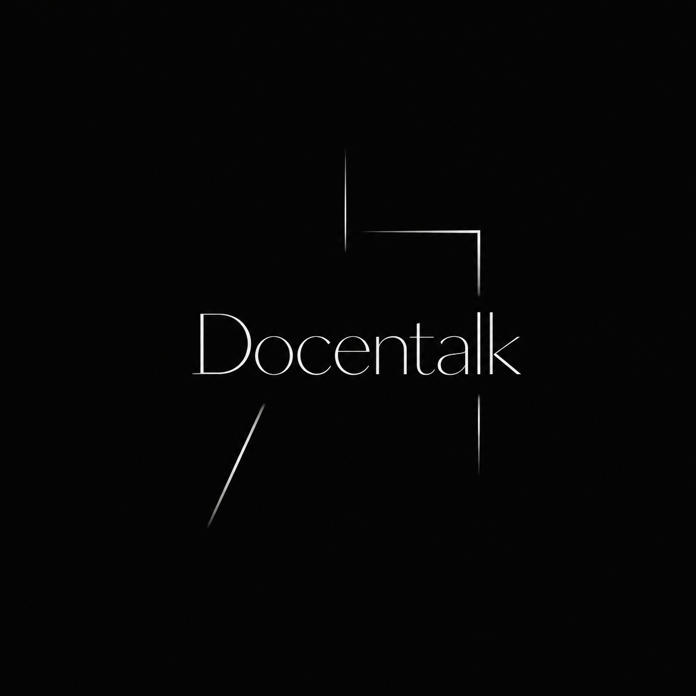

# Docentalk

### 그림을 만나고, 이야기를 나누고, 나의 시선을 기록하다.

**자료에 근거한 AI 도슨트와 함께 작품을 이해하고, 감상과 취향을 쌓아가는 온라인 미술관**

[서비스 바로가기](http://13.125.176.74) · [테스트 결과서](docs/01_테스트결과.pdf) · [시스템 구성도](docs/02_시스템구성도.md) · [3차 프로젝트](https://github.com/SKNETWORKS-FAMILY-AICAMP/SKN35-3rd-1Team)

</div>

<a id="team"></a>

## 팀 소개 · 담당 역할

**SKN35 4th Project · 1Team** — 3차 Docentalk을 Django 백엔드, LangGraph 답변 흐름, 하이브리드 검색, AWS 배포로 고도화했습니다.

| 프로필 | 팀원 | 4차 담당 영역 |
| :---: | --- | --- |
|  | **고태민** | Django 백엔드 이식 (Ninja API, ORM 모델, Admin), DB 복사·전환, 발표 |
|  | **김연주** | 웹 초기 화면 제작 |
| 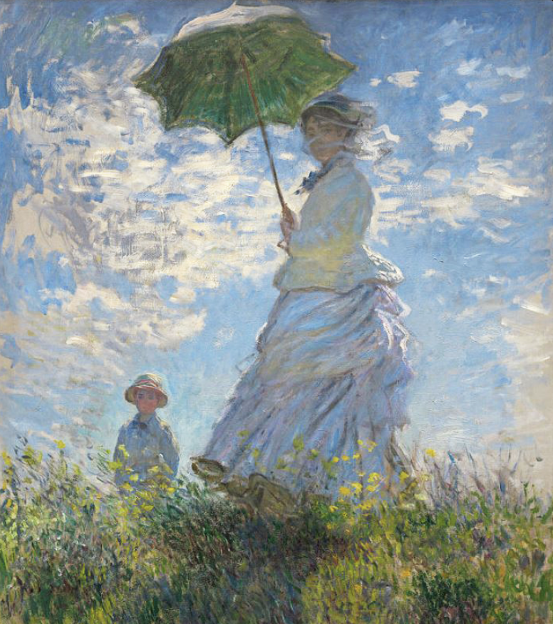 | **박수휘** | AWS EC2(Docker Compose + nginx)로 프론트·백엔드 통합 배포, Dockerfile·docker-compose·nginx 설정, 산출물 작성 (시스템 구성도, 화면설계서, 요구사항 정의서) |
| 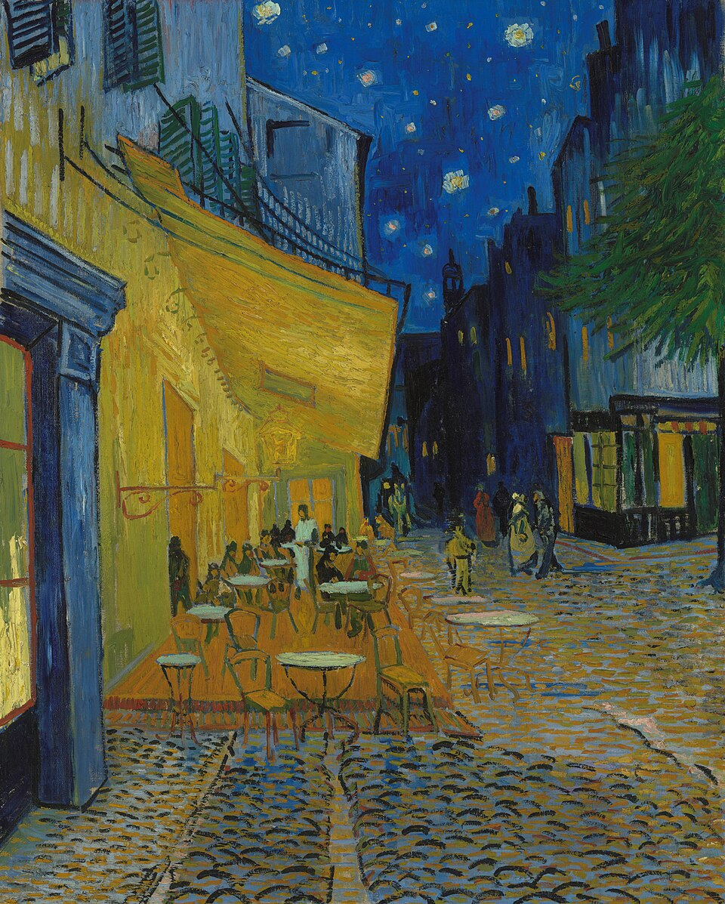 | **차윤정** | LangGraph 답변 파이프라인 구성, 하이브리드 검색 도입 (벡터 + BM25, RRF), 거절 판정(`refused`) 정합성 보정, RAG 품질 평가 · 배포 환경 통합 테스트 |

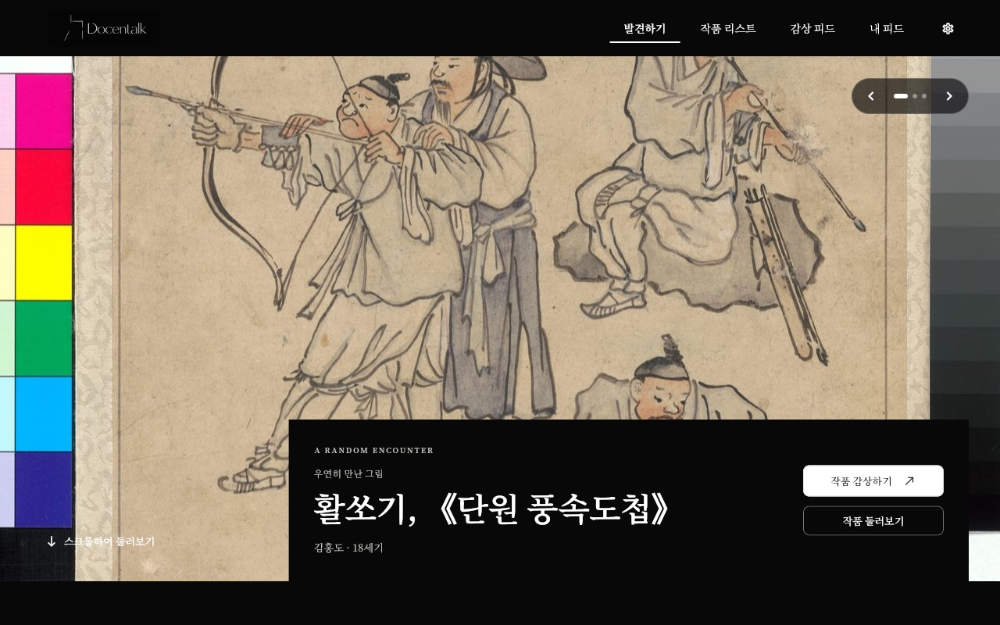

> SK Networks Family AI Camp 35기 · 4차 프로젝트 · 1팀<br />
> 주제: **LLM을 연동한 내외부 문서 기반 질의응답 웹페이지 개발**<br />
> 문서 기준: 2026.11.05 · 배포: AWS EC2 `http://13.125.176.74` · 평가 수치는 [테스트 결과서](docs/01_테스트결과.pdf)와 `docs/eval/` 실행 기록 기준입니다.

## 목차

[팀 소개 · 담당 역할](#team)

1. [4차에서 달라진 점](#1-4차에서-달라진-점)
2. [서비스 소개](#2-서비스-소개)
3. [주요 기능](#3-주요-기능)
4. [서비스 화면](#4-서비스-화면)
5. [시스템 구성과 기술 선택](#5-시스템-구성과-기술-선택)
6. [AI 도슨트: LangGraph와 하이브리드 검색](#6-ai-도슨트-langgraph와-하이브리드-검색)
7. [데이터와 ERD](#7-데이터와-erd)
8. [테스트 결과와 남은 과제](#8-테스트-결과와-남은-과제)
9. [실행 방법](#9-실행-방법)
10. [산출물 문서](#10-산출물-문서)
11. [프로젝트 폴더 구조](#11-프로젝트-폴더-구조)

## 1. 4차에서 달라진 점

4차는 3차 서비스의 기능과 화면을 **그대로 유지**하면서, 과제 기술 요구(Django, 클라우드 직접 배포)에 맞게 서버를 다시 만들고 3차 평가에서 남은 과제를 해결했습니다.

| 영역 | 3차 | 4차 |
| --- | --- | --- |
| 백엔드 | FastAPI, SQLAlchemy, Alembic | **Django 6.0 + Django Ninja**, Django ORM (기존 테이블을 쓰는 `managed = False` 모델 22개), Django Admin |
| 답변 흐름 | 일반 답변과 스트리밍에 같은 흐름이 따로 구현됨 | **LangGraph 그래프 하나**를 일반 답변과 스트리밍이 함께 사용 |
| 검색 | 벡터 검색만 사용 | **벡터 + 한국어 BM25를 RRF로 합친 하이브리드 검색** |
| 거절 표시 | 본문은 "확인할 수 없다"인데 `refused=false`인 경우가 있음 (6/8) | 서버 검증 단계에서 바로잡음 (**8/8**) |
| 배포 | Vercel(화면) + Railway(API), 주소 2개 | **AWS EC2 + Docker Compose + nginx**, 화면·API 주소 1개 |
| CI | 없음 | **GitHub Actions**: pytest, 배포 이미지 빌드, nginx 설정 검사 |
| DB | TiDB Cloud `3rd_project` | 3차 데이터를 복사한 `4th_project` (전체 행 해시 일치 확인 후 전환) |

| 3차에서 남은 과제 | 4차 결과 |
| --- | --- |
| `refused` 상태값 정합성 6/8 | **8/8** (로컬·배포 모두) |
| 청크 검색 Recall@5 0.787 / MRR 0.778 / nDCG@5 0.751 (목표 0.85 / 0.80 / 0.80) | **0.870 / 0.852 / 0.828**, 세 지표 모두 통과 |
| 같은 흐름이 두 곳에 있어 한쪽만 고치면 동작이 달라짐 | LangGraph 그래프 하나로 통합 |

## 2. 서비스 소개

**Docentalk**은 작품을 고르는 순간부터 감상을 남기는 순간까지 이어지는 미술 감상 서비스입니다. 작품 상세에서 AI 도슨트에게 질문하면, **팀이 수집·검수한 미술 자료 안에서만** 답하고 근거 자료의 제목·출처·이용 조건을 함께 보여 줍니다. 근거가 없으면 지어내지 않고 확인할 수 없다고 안내합니다.

| 핵심 경험 | 사용자에게 제공하는 가치 |
| --- | --- |
| 발견 | 큰 작품 이미지와 작가·사조별 탐색으로 첫 감상을 시작합니다. |
| 이해 | 궁금한 디테일을 질문하고, Easy / Standard / Deep 설명 방식을 고릅니다. |
| 확인 | 답변에 실제로 쓰인 근거 자료와 원문 출처를 직접 확인합니다. |
| 기록 | 감상을 공개·비공개로 남기고 날짜별 캘린더로 다시 찾습니다. |
| 연결 | 다른 사람의 감상과 내 관심 기록에서 다음 작품·컬렉션을 만납니다. |

### 내외부 문서

| 구분 | 내용 |
| --- | --- |
| 외부 문서 | 미술관·박물관 공식 작품 페이지, 국립중앙박물관, 한국학중앙연구원 등에서 수집한 작품 해설·작가 생애·연표·작가 비교 자료 |
| 내부 문서 | 팀이 검수해 작성한 보정문·보강문 (`data/mappings/document_corrections.json`, `document_supplements.json`). 답변할 때 보정문을 우선합니다. |

## 3. 주요 기능

3차의 모든 기능을 유지합니다. API 54개의 주소와 응답 모양을 3차와 같게 맞춰서, 3차 Flutter 화면을 그대로 사용합니다.

| 영역 | 기능 | 주요 동작 |
| --- | --- | --- |
| 발견하기 | 오늘의 그림 | 3개 작품을 전환하는 전시형 메인, 로그인 시 맞춤 추천 |
| 작품·작가 탐색 | 검색·필터·상세 | 제목·작가 검색, 사조별 필터, 작가 소개와 작품 모음 |
| AI 도슨트 | 작품별 질의응답 | 예시 질문, **스트리밍 답변**, Easy / Standard / Deep, 후속 질문, 로그인 시 대화 저장·복원 |
| 근거 확인 | 답변 출처 | 실제로 쓴 자료의 제목·기관·URL·라이선스, 편집 근거 |
| 거절 | 범위 밖·근거 부족 | 날씨·시세·미수집 작가, 근거 없는 비교, 자료에 없는 세부 사항은 지어내지 않고 안내 |
| 감상 기록 | 공개·비공개 감상 | 작품별 감상 작성·수정·삭제, 감상 피드, 작성자 프로필·팔로우 |
| 내 피드 | 감상·취향 모아보기 | 내 감상, AI 한 줄 취향 소개, 관심 작가, 감상 캘린더 |
| 컬렉션 | 직접·자동·AI 테마 | 좋아요 모음, 직접 만든 컬렉션(최대 10개·각 30점), AI 취향 테마, 채팅으로 만들기·담기 |
| 관리자 | Django Admin | 사조·작가·작품·문서를 관리 화면 개발 없이 조회·수정 (`/admin/`) |
| MCP | 외부 AI 도구 연동 | 인증된 6개 도구로 컬렉션 조회·작품 검색·생성·담기 (`/mcp/`) |
| 로그인 | 이메일·Google | Firebase Auth. 서버는 ID 토큰만 검증하고 사용자를 구분 |

> **이용 범위:** 작품 탐색·공개 감상 읽기·도슨트 질문은 로그인 없이 할 수 있습니다. 좋아요·감상 작성·대화 저장·컬렉션은 로그인한 계정에 연결됩니다.

## 4. 서비스 화면

배포 사이트에서 캡처한 화면입니다. 화면별 구성 요소와 연결 API는 [화면설계서](docs/03_화면설계서.md)에 있습니다.

| 발견하기 (메인) | 작품 리스트 |
| --- | --- |
| 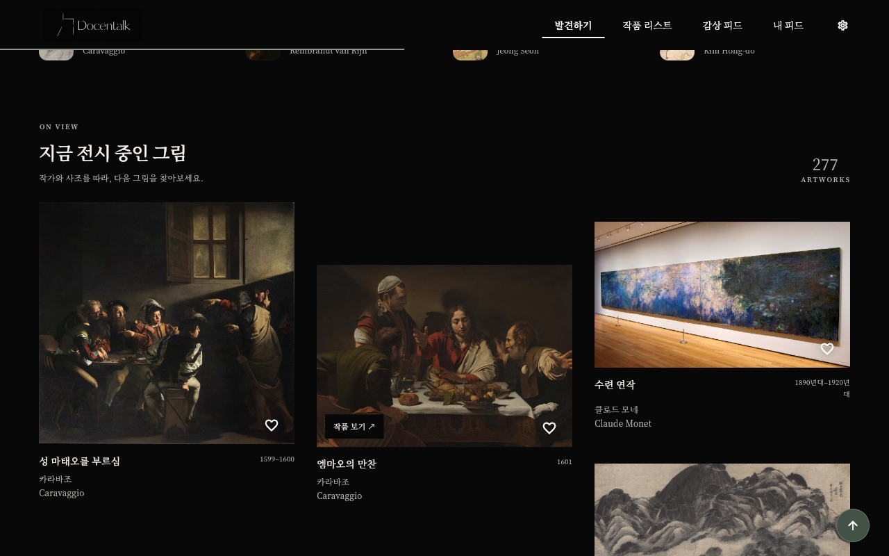 | 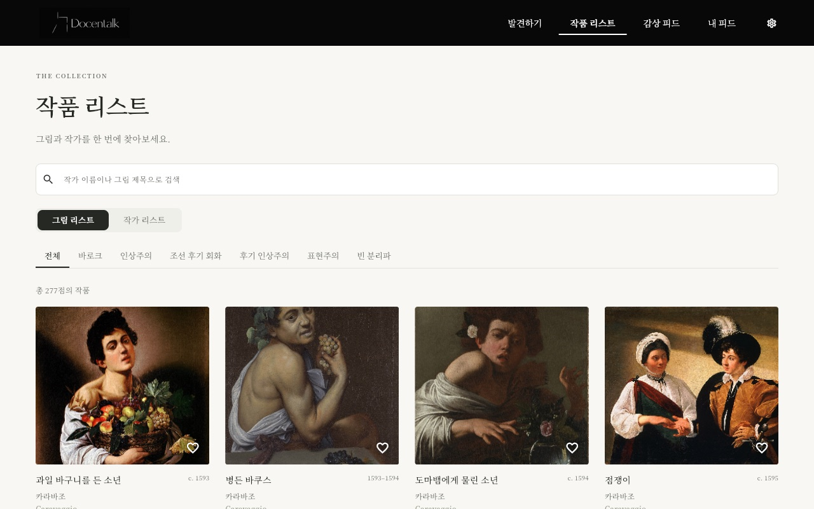 |

| 작가 리스트 | 작가 상세 |
| --- | --- |
| 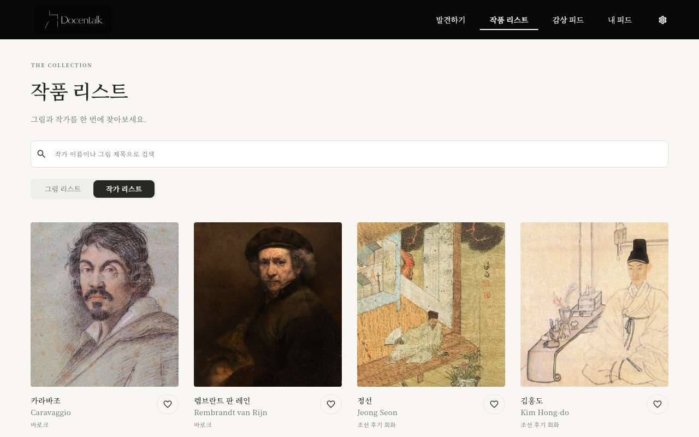 | 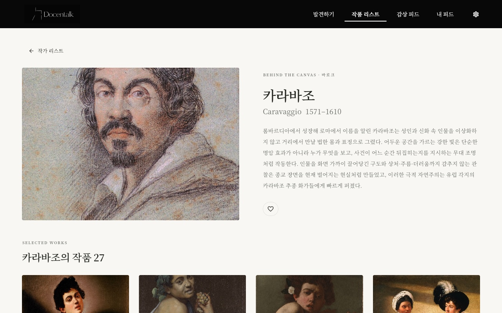 |

### 작품 상세와 AI 도슨트

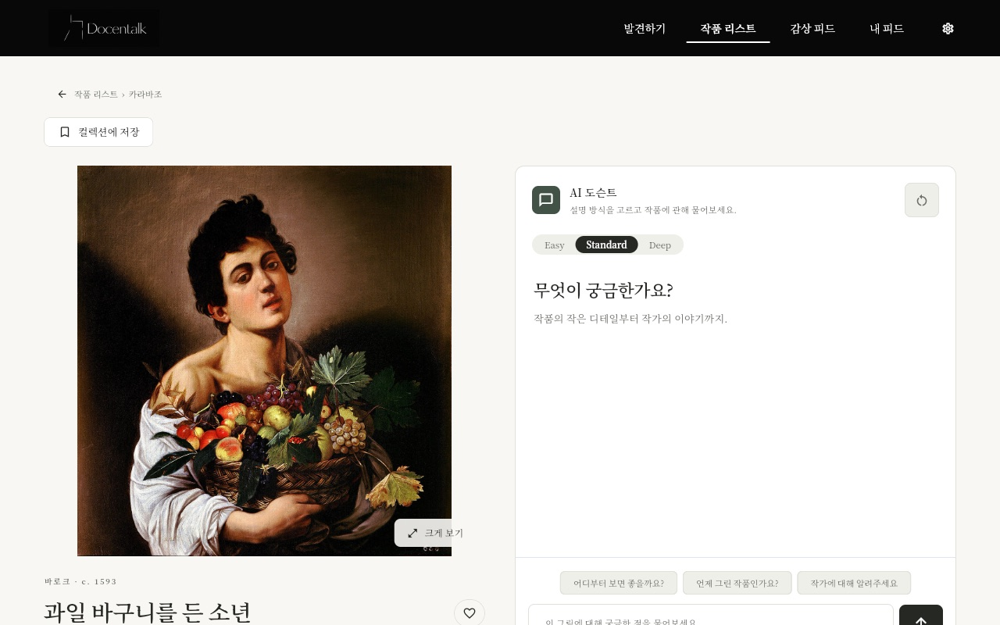

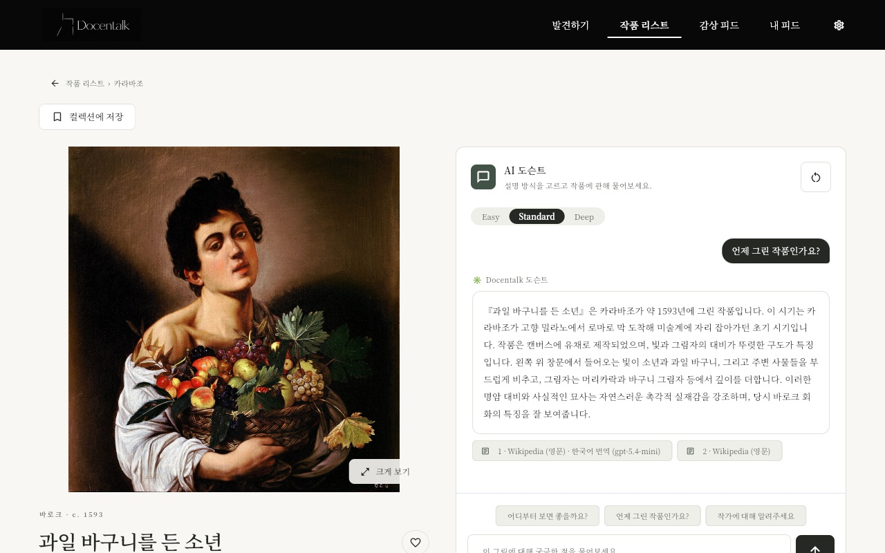

<details>
<summary>감상 피드 · 사용자 프로필 · 내 피드 · 설정 화면 보기</summary>

| 감상 피드 | 사용자 프로필 |
| --- | --- |
| 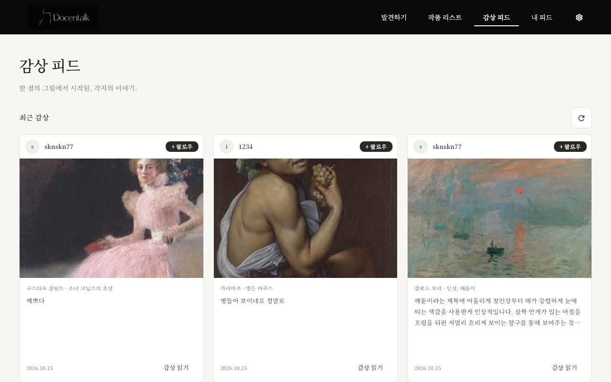 | 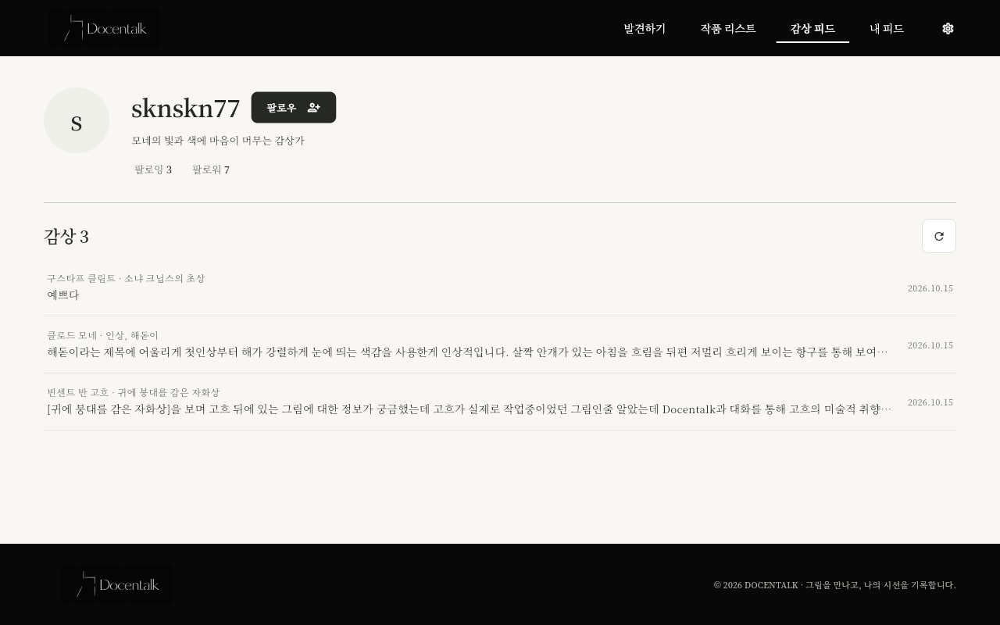 |

| 내 피드 | 설정 |
| --- | --- |
| 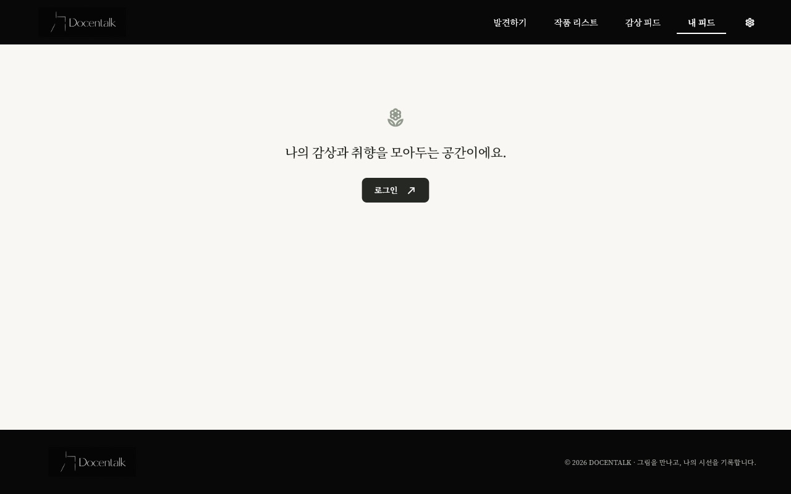 | 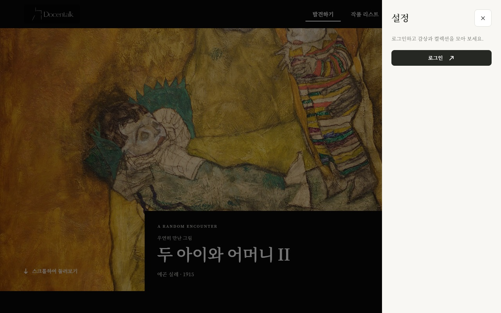 |

</details>

## 5. 시스템 구성과 기술 선택

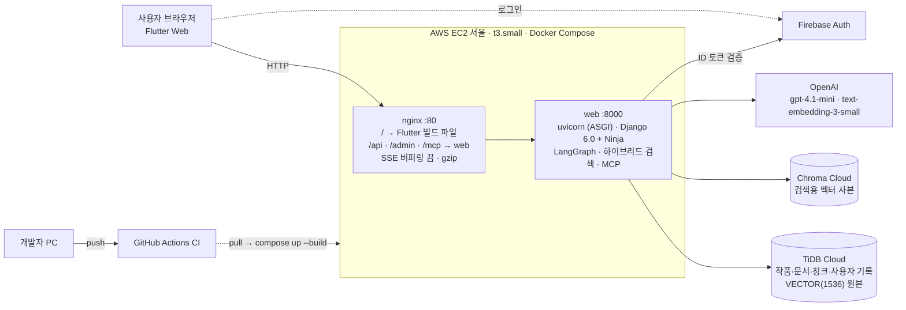

**브라우저는 TiDB·Chroma·OpenAI에 직접 연결하지 않습니다.** 비밀값(DB 비밀번호, 모델 키, Firebase 서비스 계정)은 서버의 `.env`에만 두고 Git과 Docker 이미지에는 넣지 않습니다. 화면과 API를 nginx 한 주소로 제공해서 3차의 CORS 설정이 필요 없어졌습니다. 자세한 내용은 [시스템 구성도](docs/02_시스템구성도.md)와 [기술적 의사결정 기록](docs/decisions.md)에 있습니다.

| 계층 | 기술 | 선택 이유·역할 |
| --- | --- | --- |
| 프론트 | Flutter Web (3차 화면 유지) | 빌드 결과물을 nginx가 서빙. API 주소는 같은 도메인의 `/api` |
| 백엔드 | Django 6.0, Django Ninja, uvicorn (ASGI) | 과제 요구 기술. Ninja는 FastAPI와 문법이 비슷해 API 54개를 그대로 옮김. 스트리밍과 MCP를 위해 ASGI로 실행 |
| DB | TiDB Cloud, `django-tidb`, PyMySQL (TLS) | 벡터 칼럼(`VECTOR(1536)`)과 거리 검색이 필요해 RDS 대신 유지. 3차 데이터 재적재 없음 |
| LLM 연동 | LangChain, **LangGraph** | 분류 → 범위 판정 → 검색 → 생성 → 검증을 그래프 하나로 구성 |
| 검색 | Chroma Cloud, **kiwipiepy, rank-bm25** | 벡터 순위와 한국어 BM25 순위를 RRF로 합침 |
| 생성·임베딩 | OpenAI `gpt-4.1-mini`, `text-embedding-3-small` (1536차원) | 근거 기반 답변·구조화 출력, 질문·청크 임베딩 |
| 인증 | Firebase Auth, firebase-admin | 이메일·Google 로그인, 서버 ID 토큰 검증 |
| 외부 도구 | MCP Python SDK (Streamable HTTP) | 컬렉션 도구 6개를 인증된 경로로 제공 |
| 배포 | AWS EC2, Docker Compose, nginx 1.27 | 서버를 직접 구성. 로컬과 서버에서 같은 이미지로 실행 |
| CI | GitHub Actions | push·PR마다 pytest, 배포 이미지 빌드, nginx 설정 검사 |
| 품질 | pytest, Ruff, 구조화 LLM Judge (RAGAS 정의) | 회귀·검색·답변·거절·근거·응답 시간 평가 |

## 6. AI 도슨트: LangGraph와 하이브리드 검색

### LangGraph 답변 흐름

3차에서는 일반 답변(`/chat`)과 스트리밍(`/chat/stream`)이 같은 흐름을 각자 구현해서, 한쪽만 고치면 동작이 달라지고 평가(일반 답변)와 실제 화면(스트리밍)이 서로 다른 코드를 거쳤습니다. 4차에서는 흐름을 그래프 하나(`backend/llm/docent/graph.py`)로 합쳤습니다.

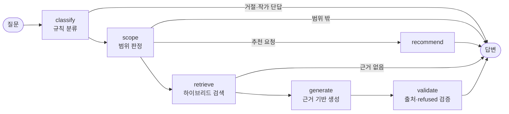

- 스트리밍일 때는 `generate` 노드가 LangGraph custom stream으로 토큰을 바로 보냅니다. 화면은 `token`으로 글자를 먼저 표시하고, `done`에서 검증된 최종 답변과 출처로 확정합니다.
- 그래프로 바꾼 뒤 39문항을 3차 코드와 나란히 돌려 **검색 청크·자동 검사 결과가 39/39 같음**을 확인했습니다. 구조만 바뀌고 동작은 그대로입니다.

### 하이브리드 검색

벡터 검색만 쓰면 작품명·기법명·연도처럼 단어가 정확히 맞아야 하는 질문에서 생애·연표 같은 긴 문서가 위로 올라왔습니다. 4차에서는 범위 안 청크에 대해 두 순위를 합칩니다.

```text
점수 = 1 / (60 + 벡터 순위) + 2 / (60 + BM25 순위)
```

- BM25는 kiwipiepy로 명사·고유명사·숫자만 색인하고, 작가 별칭을 사용자 사전에 넣어 "렘브란트", "카라바조" 같은 이름이 쪼개지지 않게 했습니다.
- 작품 해설 자리 보장, 비교 문서 자리, 문서별 상한 같은 3차의 자리 규칙은 이 순위 위에서 그대로 적용합니다.
- 방식은 18문항 메모리 실험으로 골랐습니다. RRF 1:1은 목표에 못 미쳤고, BM25 비중 2배가 세 지표를 모두 넘었습니다. 비중 1.5~3배, k 10~60 범위에서 모두 목표를 넘어 특정 값에 맞춘 결과가 아닙니다.
- DB와 Chroma는 바꾸지 않았습니다. 순위는 요청이 들어올 때 메모리에서 계산합니다.

### `refused` 보정

모델이 답변 본문에는 "자료로 확인할 수 없다"고 쓰고 `refused=false`로 보내는 경우가 있었습니다. 그래프의 `validate` 단계에서 서버가 한 번 더 검사합니다. 질문이 "정확히", "단정"을 요구하고, 답변의 첫 문장이나 결론 문장("따라서", "그러나"로 시작)이 근거 부족 표현이면 `refused=true`로 바로잡고 출처를 비웁니다. 일부만 모르는 정상 답변은 그대로 둡니다. 규칙을 넣기 전에 지난 평가 답변 360건에 적용해, 바로잡아야 할 16건을 잡고 정상 답변을 잘못 거절한 경우는 0건임을 확인했습니다.

## 7. 데이터와 ERD

**작가 10명 · 작품 277점 · 문서 426건 · 청크 1,775개**입니다. 3차 데이터를 `4th_project` DB로 복사하고 전체 행 해시가 같은지 확인한 뒤 전환했습니다. 3차 원본 `3rd_project`에는 `migrate`를 실행하지 않습니다.

| 범위 | 작가 |
| --- | --- |
| 바로크 | 카라바조, 렘브란트 판 레인 |
| 인상주의·후기 인상주의 | 클로드 모네, 폴 세잔, 빈센트 반 고흐, 폴 고갱 |
| 빈 분리파·표현주의 | 구스타프 클림트, 에곤 실레 |
| 조선 후기 회화 | 김홍도, 정선 |

테이블 구조는 3차와 같은 **서비스 테이블 22개**입니다. Django 모델은 `inspectdb`로 기존 테이블에서 만들고 `managed = False`로 두어, Django가 테이블을 새로 만들거나 바꾸지 않습니다. 벡터 추천(`VEC_COSINE_DISTANCE`)과 열람 수 증가(`ON DUPLICATE KEY UPDATE`)는 ORM 표현이 없거나 원자성이 필요해 SQL로 남겼습니다.

| 영역 | 테이블 |
| --- | --- |
| 계정·설정 (`accounts`) | `users`, `social_accounts`, `user_preferences` |
| 작품 카탈로그 (`catalog`) | `art_movements`, `artists`, `artworks`, `artwork_embeddings` |
| 감상·관계·컬렉션 (`library`, `chat`) | `artwork_likes`, `artist_follows`, `artwork_views`, `user_follows`, `diary_entries`, `collections`, `collection_items`, `chat_sessions`, `chat_messages`, `theme_collection_cache` |
| 문서·근거 (`documents`) | `documents`, `document_artists`, `document_artworks`, `document_basis_documents`, `document_chunks` |

[전체 ERD (3차 문서)](https://raw.githubusercontent.com/SKNETWORKS-FAMILY-AICAMP/SKN35-3rd-1Team/fa19b03165ed6d7e7f4903f0db348c0df06fb55d/docs/readme-2026-10-15/diagrams/full-erd.svg)

**작품 이미지와 원문의 권리는 각 소장 기관·저작권자에게 있습니다.** 서비스의 출처 표시가 모든 자료의 자유로운 재사용을 뜻하지는 않습니다.

## 8. 테스트 결과

3차와 같은 **45문항**(고정 회귀 30 + 프롬프트 정확도 9 + 말투 3 + 청크 경계 3)으로 단계마다 평가했습니다. 문서 검색은 23문항, 청크 검색은 18문항으로 따로 평가했습니다. 전체 과정은 [테스트 결과서](docs/01_테스트결과.pdf)에 있습니다.

| 지표 | 목표 | 3차 최종 (Railway) | 4차 로컬 Django | **4차 배포 EC2** |
| --- | --- | ---: | ---: | ---: |
| HTTP 성공률 | 99% 이상 | 45/45 | 45/45 | **45/45** |
| 종합 통과율 | 90% 이상 | 43/45 (95.6%) | 44/45 (97.8%) | **44/45 (97.8%)** |
| `refused` 정합성 | — | 6/8 | 8/8 | **8/8** |
| 정상 질문 오거절 없음 · 출처 | 95% 이상 | 37/37 | 36/37 | **36/37 (97.3%)** |
| Faithfulness | 0.90 이상 | 0.9865 | 0.9716 | **0.9878** |
| Answer Relevancy / Correctness | 0.85 이상 | 1.0000 / 1.0000 | 1.0000 / 0.9811 | **0.9932 / 0.9946** |
| 금지 주장 (환각) | 0건 | 0 | 0 | **0** |
| P50 / P95 응답 시간 | P95 10초 이하 | 4.40 / 5.86초 | 5.56 / 10.06초 | **5.15 / 6.68초** |
| 문서 Hit@5 | 90% 이상 | 23/23 | 23/23 | 23/23 |
| 청크 Recall@5 / MRR / nDCG@5 | 0.85 / 0.80 / 0.80 | 0.787 / 0.778 / 0.751 | 0.870 / 0.852 / 0.828 | **0.870 / 0.852 / 0.828** |

| 그 밖의 테스트 | 결과 |
| --- | --- |
| 백엔드 테스트 | 171/171 |
| Django 이식 확인 | API 경로·메서드 54/54, 조회 응답 스냅샷 393/393, 함수 기준값 550/550, 쓰기 흐름 44/44 |
| 인증 | Firebase 실제 토큰 5/5, 토큰 없음·잘못된 토큰·위조·만료 모두 401 |
| 배포 환경 확인 | 화면·라우팅·공개 API·인증·채팅(SSE 포함)·보안 31개 항목 중 29개 통과 |

- 오거절·출처 지표의 목표는 3차 100%에서 4차 95% 이상으로 바꿨습니다. 정상 질문 37개 중 한 문항의 무작위 결과에 판정이 좌우되기 때문이고, 이유는 결과서 「기준 변경」에 적었습니다. 환각·`refused`·Faithfulness 기준은 바꾸지 않았습니다.
- 남은 실패 1건(`prompt-008`, 원문 복사 요청)은 3차 코드에서도 실행마다 통과·실패가 갈리는 경계 문항이고, 지어낸 내용 없이 안전한 쪽(과잉 거절)으로 실패한 경우입니다.
- 생성 점수는 RAGAS 정의를 적용한 구조화 LLM Judge 결과입니다. 답변과 평가에 같은 모델을 써서 편향 가능성이 있으므로 실제 답변·출처·기대 조건을 함께 확인했습니다.


## 9. 실행 방법

비밀번호·API 키·서버 인증 키는 README나 클라이언트 소스에 넣지 않습니다. `.env.example`을 복사해 값을 채웁니다.

### 백엔드 (로컬)

```bash
cp .env.example .env
uv sync
cd backend && uv run uvicorn config.asgi:application --reload
```

- `http://localhost:8000/api/health` → `{"status": "ok"}`, API 문서는 `/api/docs`입니다.
- 채팅 스트리밍, MCP(`/mcp`), CORS는 ASGI에서 동작하므로 `runserver`가 아니라 `uvicorn`으로 실행합니다.
- `.env`의 `TIDB_DATABASE`는 `4th_project`로 둡니다.

### 화면 + 서버 (Docker, 배포와 같은 구성)

```bash
./infra/build-frontend.sh
HTTP_PORT=8080 docker compose -f infra/docker-compose.yaml up -d --build
```

`http://localhost:8080`에서 화면과 API를 같은 주소로 확인합니다. EC2 배포 순서는 [infra/README.md](infra/README.md)에 있습니다.

### 테스트와 평가

```bash
cd backend && uv run pytest -q
```

```bash
cd backend && uv run python -m scripts.eval_round3 --base-url http://127.0.0.1:8000 --out ../docs/eval/<파일>.json
```

평가는 DB를 읽기만 하고, 로그인 없이 질문해서 대화를 저장하지 않습니다. OpenAI 호출 비용이 듭니다.

## 10. 산출물 문서

| 산출물 | 문서 |
| --- | --- |
| 요구사항 정의서 | [docs/04_요구사항정의서.md](docs/04_요구사항정의서.md) |
| 화면설계서 | [docs/03_화면설계서.md](docs/03_화면설계서.md) |
| LLM 연동 웹 애플리케이션 | 배포 사이트 [http://13.125.176.74](http://13.125.176.74), 이 저장소 |
| 시스템 구성도 | [docs/02_시스템구성도.md](docs/02_시스템구성도.md) |
| 테스트 계획 및 결과 보고서 | [docs/01_테스트결과.pdf](docs/01_테스트결과.pdf), 원시 결과 `docs/eval/` |
| 4차 계획 | [docs/00_4차_계획정리.pdf](docs/00_4차_계획정리.pdf) |
| 기술적 의사결정 기록 | [docs/decisions.md](docs/decisions.md) |

## 11. 프로젝트 폴더 구조

```text
SKN35-4th-1Team/
├── backend/                    Django 프로젝트
│   ├── config/                 설정, Ninja API 등록, ASGI(Django + MCP + CORS), DB 연결
│   ├── accounts/               회원·프로필·사용자 팔로우·Firebase 인증
│   ├── catalog/                사조·작가·작품·추천
│   ├── chat/                   도슨트 채팅 API(JSON·SSE)·대화 저장
│   ├── library/                좋아요·팔로우·열람·감상·컬렉션·AI 테마·MCP 서버
│   ├── documents/              문서·청크·검색 범위·출처
│   ├── llm/
│   │   ├── docent/             LangGraph 그래프·스트리밍·근거 검증·범위 판정
│   │   ├── rag/                질문 분류·청킹·하이브리드 순위·검색기·프롬프트
│   │   └── clients/            Chroma·임베딩 연결
│   ├── scripts/                전처리·적재·Chroma 동기화·평가 (python -m scripts.x)
│   ├── tests/                  단위·회귀 테스트, 평가 문항
│   └── manage.py
├── frontend/                   Flutter Web (3차 화면 유지)
├── data/                       수집 원자료·전처리 산출물·보정문
├── infra/                      Dockerfile, docker-compose, nginx 설정, 프론트 빌드 스크립트
├── .github/workflows/ci.yml    GitHub Actions CI
├── docs/                       산출물 문서·평가 결과·화면 캡처
└── pyproject.toml / uv.lock    Python 의존성
```
