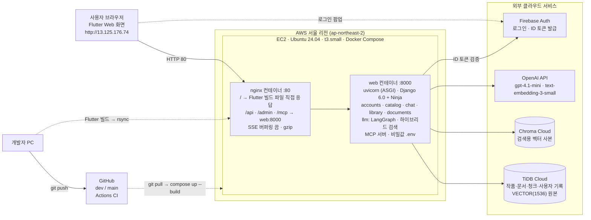
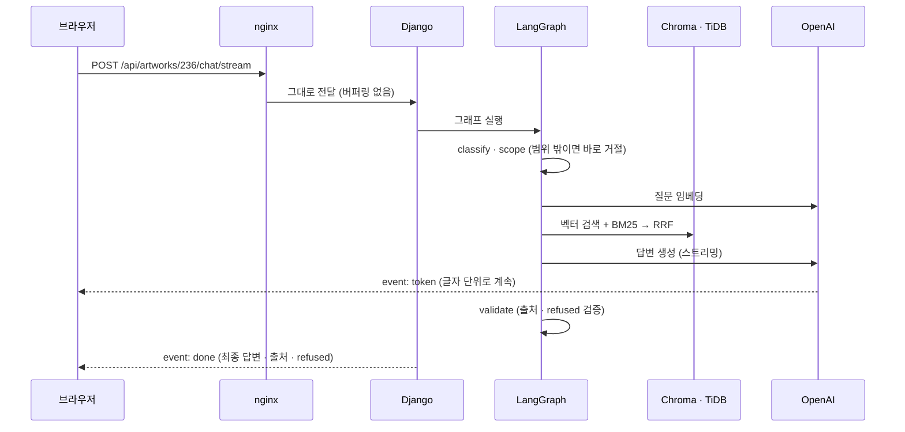
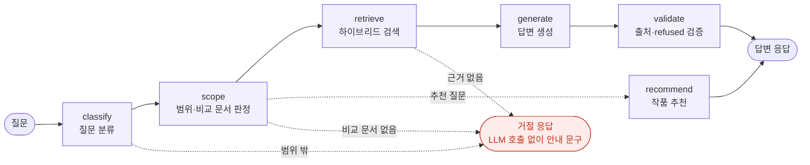
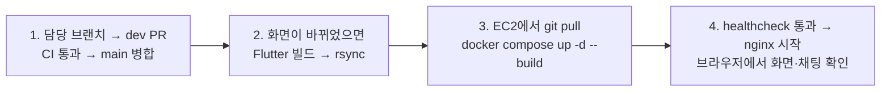

# 4차 시스템 구성도

_SKN35 4차 1팀 · Docentalk (근거 기반 AI 미술관 도슨트) · AWS EC2 배포 기준 · 2026-11-04_

> **요약**
> - **서버 1대**: AWS EC2(서울, t3.small) 위에 Docker Compose로 `nginx`와 `web`(Django) 컨테이너 2개를 띄운다.
> - **주소 1개**: nginx가 화면(Flutter 빌드 파일)과 API(`/api`)를 같은 주소로 제공한다. 3차의 Vercel·Railway 분리 구조를 없애 CORS 설정이 필요 없다.
> - **외부 서비스**: 데이터는 TiDB Cloud(원문·사용자 기록·벡터 원본), 검색은 Chroma Cloud, 답변 생성과 임베딩은 OpenAI, 로그인은 Firebase Auth.
> - **답변 흐름**: LangGraph 그래프 하나(분류 → 범위 → 검색 → 생성 → 검증)를 일반 답변과 스트리밍이 함께 쓴다. 검색은 벡터 + 한국어 BM25를 RRF로 합친 하이브리드 검색.

## 1. 전체 구성도

_실선은 서비스 요청, 점선은 로그인과 배포 흐름_

### 구성 요소

| 구분 | 기술 | 역할 |
|---|---|---|
| 클라우드 서버 | AWS EC2 (서울, t3.small, Ubuntu 24.04, gp3 20GB, 스왑 2GB) | 앱을 24시간 실행하는 가상 서버. 탄력적 IP로 주소를 고정 |
| 컨테이너 | Docker Compose (`infra/docker-compose.yaml`) | `nginx` + `web` 두 컨테이너를 한 번에 빌드·실행. 서버가 재부팅돼도 자동 재시작 |
| 웹 서버 | nginx 1.27 | 화면 정적 파일 응답, API 전달, SSE 스트리밍 버퍼링 해제, gzip 압축 |
| 프론트엔드 | Flutter Web (3차 화면 유지) | 빌드 결과물(HTML·CSS·JS)을 nginx가 서빙. API 주소는 같은 도메인의 `/api` |
| 백엔드 | Django 6.0 + Django Ninja, uvicorn(ASGI) | API 54개, Django Admin, MCP 서버. 스트리밍 응답을 위해 ASGI로 실행 |
| LLM 연동 | LangChain + LangGraph | 질문 분류 → 범위 판정 → 검색 → 답변 생성 → 근거 검증 그래프 |
| 검색 | Chroma Cloud + kiwipiepy + rank_bm25 | 벡터 순위와 한국어 BM25 순위를 RRF(k=60, BM25 비중 2)로 합침 |
| DB | TiDB Cloud (`django-tidb`, TLS) | 작품 277점·문서 426건·청크 1,775개, 사용자·대화·좋아요·컬렉션 기록 |
| LLM·임베딩 | OpenAI gpt-4.1-mini / text-embedding-3-small (1536차원) | 답변 생성, 질문 임베딩 |
| 인증 | Firebase Auth + firebase-admin | 브라우저가 로그인, 서버는 ID 토큰만 검증해 사용자 구분 |
| CI | GitHub Actions (`.github/workflows/ci.yml`) | push·PR마다 pytest, 배포 이미지 빌드, nginx 설정 검사 |

## 2. 요청 처리 흐름

| 요청 | 예시 경로 | 처리 순서 |
|---|---|---|
| 화면 열기 | `/`, `/#/artwork/236` | 브라우저 → nginx가 `index.html`·`main.dart.js`를 바로 응답 (Django 거치지 않음). 없는 경로는 `index.html`로 돌려 Flutter가 화면을 고름 |
| 작품·작가 조회 | `GET /api/artworks` | nginx → web(Django Ninja) → Django ORM → TiDB → JSON 응답 |
| 로그인이 필요한 요청 | `GET /api/me/chats` | 브라우저가 Firebase ID 토큰을 `Authorization: Bearer`로 전송 → 서버가 firebase-admin으로 검증 → TiDB의 사용자와 연결. 토큰이 없거나 틀리면 401 |
| 도슨트 질문 (스트리밍) | `POST /api/artworks/{id}/chat/stream` | nginx(버퍼링 끔) → Django → LangGraph 그래프 실행 → 답변 토큰을 SSE `token` 이벤트로 바로 전송 → 검증이 끝나면 `done`(최종 답변·출처·`refused`) 또는 `replace`(거절 문구로 교체) |
| 관리자 | `/admin/` | nginx → Django Admin. 작품·문서를 관리 화면 없이 바로 수정. CSS도 `/admin/static/` 아래라 같은 경로로 전달 |
| MCP 도구 | `/mcp/` | nginx → Starlette에 마운트된 MCP 서버 (컬렉션 조회 도구) |

### 도슨트 질문 순서

## 3. 도슨트 답변 흐름 (LangGraph)

_`backend/llm/docent/graph.py` — 점선은 조건 분기. 일반 답변과 스트리밍이 같은 그래프를 씀_

| 노드 | 하는 일 |
|---|---|
| `classify` | 질문을 RAG / 거절 / 추천 / 단답으로 분류. 미수집 작가, 날씨·시세·구매처 같은 범위 밖 질문은 여기서 끝냄 |
| `scope` | 고른 작품·작가 기준으로 허용 문서 범위를 정함. 다른 작가와의 비교인데 두 작가를 함께 다룬 비교 문서가 없으면 거절 |
| `retrieve` | 질문 임베딩 → Chroma 벡터 순위 + 한국어 BM25 순위 → RRF로 합침. 작품 해설 보장 자리 3, 비교 문서 보장 자리 2, 문서당 최대 2청크, 최종 5청크 |
| `generate` | 질문 + 대화 이력 + 검색 문서 + 설명 스타일(easy/standard/deep)을 gpt-4.1-mini에 전달. 스트리밍에서는 이 노드의 토큰을 바로 내보냄 |
| `validate` | 답변이 실제로 쓴 출처가 검색 문서인지 확인. 출처가 없거나 "확인할 수 없다"는 결론이면 서버가 `refused=true`로 보정 |

## 4. 배포 구조

### EC2 · 네트워크

| 항목 | 설정 |
|---|---|
| 리전 · VPC | 서울(ap-northeast-2), 기본 VPC (172.31.0.0/16) |
| 인스턴스 | t3.small (2 vCPU, 메모리 2GB) + 스왑 2GB, gp3 20GB |
| 주소 | 탄력적 IP `13.125.176.74` (재시작해도 유지). 도메인·HTTPS는 사용하지 않음 |
| 보안 그룹 `docentalk-sg` | 22(SSH): 관리자 IP만 · 80(HTTP): 전체 · 443(HTTPS): 전체 · 그 외 차단. 8000번(Django)은 외부에 열지 않고 nginx만 접근 |
| 접속 | SSH 키 페어(`.pem`)로만 접속, 비밀번호 로그인 없음 |

### 배포 순서

| 순서 | 어디서 | 작업 |
|---|---|---|
| 1 | 개발자 PC | 담당 브랜치 → `dev` PR → CI 통과 확인 → `main` 병합 |
| 2 | 개발자 PC | 화면이 바뀌었으면 `infra/build-frontend.sh`로 Flutter 빌드 → `rsync`로 EC2에 복사 (EC2 메모리로는 Flutter 빌드가 실패하기 쉬움) |
| 3 | EC2 | `git pull` → `docker compose -f infra/docker-compose.yaml up -d --build` |
| 4 | EC2 | healthcheck(`/api/health`)가 통과하면 nginx가 켜짐. 브라우저에서 화면·채팅 확인 |

### 데이터와 비밀값 위치

| 무엇 | 어디에 | 비고 |
|---|---|---|
| 소스 코드 | GitHub (Public) | `.env`, `*.pem`, Firebase 키는 `.gitignore`·`.dockerignore`로 제외 |
| API 키·DB 비밀번호 | EC2 `~/app/.env` (권한 600) | 컨테이너 실행 시 `env_file`로만 주입. 이미지에 포함하지 않음 |
| Firebase 서버 키 | EC2 `.env`의 `FIREBASE_SERVICE_ACCOUNT_JSON` | 서버에 키 파일을 따로 두지 않음 |
| 원문·사용자 기록 | TiDB Cloud | EC2에는 DB가 없어서 서버를 지워도 데이터 유지 |
| 검색 벡터 | Chroma Cloud | TiDB 벡터의 검색용 사본 (`scripts/sync_chroma`로 다시 만듦) |
| 화면 빌드 파일 | EC2 `~/app/frontend/build/web` | nginx가 읽기 전용으로 마운트 |

## 5. 3차 → 4차 구조 변화

| 항목 | 3차 | 4차 |
|---|---|---|
| 배포 | Vercel(프론트) + Railway(백엔드·Chroma) | **AWS EC2 + Docker Compose + nginx**, 화면과 API를 한 주소로 |
| 백엔드 | FastAPI + SQLAlchemy + Alembic | **Django 6.0 + Django Ninja + Django ORM** (API 주소·응답 모양은 3차와 동일) |
| 답변 흐름 | if문, 일반 답변과 스트리밍이 따로 구현 | **LangGraph 그래프 하나**를 두 경로가 함께 사용 |
| 검색 | 벡터 검색만 | **벡터 + 한국어 BM25 (RRF)**: Recall@5 0.787 → 0.870 |
| CI | 없음 | **GitHub Actions**: 테스트, 이미지 빌드, nginx 설정 검사 |
| DB | TiDB Cloud | TiDB Cloud 유지 (벡터 검색 때문에 RDS 대신 선택, [decisions.md](decisions.md) 참고) |
