# 4차 화면설계서

_SKN35 4차 1팀 · Docentalk (근거 기반 AI 미술관 도슨트) · 배포 화면 http://13.125.176.74 기준 · 2026-11-04_

> **개요**
> - **화면**: 3차에서 배포한 Flutter Web 화면을 그대로 쓴다. 4차에서는 백엔드(Django)와 배포(AWS)만 바뀌었고, API 주소와 응답 모양을 3차와 같게 유지해 화면 코드는 바꾸지 않았다.
> - **구성**: 화면 10개. 상단 메뉴 4개(발견하기 · 작품 리스트 · 감상 피드 · 내 피드)와 설정 패널로 이동한다.
> - **로그인**: 작품 보기와 AI 도슨트 질문은 로그인 없이 쓸 수 있다. 감상 작성, 좋아요, 팔로우, 대화 저장, 내 피드, 컬렉션은 Firebase 로그인이 필요하다.
> - **캡처**: 배포 서버를 1280×800 화면으로 캡처했다. 로그인이 필요한 화면은 로그인 전 상태로 캡처했다.

## 1. 공통 레이아웃

| 영역 | 구성 · 동작 |
|---|---|
| 헤더 | 왼쪽 Docentalk 로고(누르면 발견하기), 오른쪽 메뉴 **발견하기 · 작품 리스트 · 감상 피드 · 내 피드**와 설정(톱니) 아이콘. 현재 메뉴에 밑줄 표시. 스크롤하면 헤더가 얇아지고 읽은 위치를 가는 선으로 표시 |
| 본문 | 작품을 고르는 화면(발견하기)은 검은 전시 공간, 읽고 기록하는 화면은 밝은 종이색 배경 |
| 푸터 | 로고와 서비스 문구. 600px 이상 스크롤하면 오른쪽 아래에 **맨 위로** 버튼 |
| 반응형 | 데스크톱 4열·3열, 태블릿 2열, 모바일 1~2열. 모바일은 하단 메뉴로 이동 |
| 주소 | Flutter 해시 라우팅 (`/#/gallery`). 새로고침해도 같은 화면 유지 (nginx가 없는 경로를 `index.html`로 돌려줌) |

## 2. 화면 목록

| ID | 화면 | 경로 | 로그인 | 주요 API |
|---|---|---|---|---|
| SCR-01 | 발견하기 (메인) | `/#/gallery` | 선택 | `GET /api/artworks`, `/api/artists`, `/api/me/recommendations/*` |
| SCR-02 | 작품 리스트 | `/#/artworks` | 선택 | `GET /api/artworks`, `/api/movements` |
| SCR-03 | 작가 리스트 | `/#/artworks?view=artists` | 선택 | `GET /api/artists` |
| SCR-04 | 작가 상세 | `/#/artist/{id}` | 선택 | `GET /api/artists/{id}` |
| SCR-05 | 작품 상세 + AI 도슨트 | `/#/artwork/{id}` | 선택 | `GET /api/artworks/{id}`, `POST /api/artworks/{id}/chat/stream` |
| SCR-06 | 감상 피드 | `/#/community` | 선택 | `GET /api/diary/feed` |
| SCR-07 | 사용자 프로필 | `/#/user/{id}` | 선택 | `GET /api/users/{id}`, `/api/users/{id}/diary` |
| SCR-08 | 내 피드 | `/#/library` | **필요** | `GET /api/me/diary`, `/api/me/collections`, `/api/me/library/calendar` |
| SCR-09 | 컬렉션 상세 | `/#/collection/{id}` | **필요** | `GET /api/me/collections/{id}/items`, `POST /api/me/collections/chat` |
| SCR-10 | 설정 패널 | 헤더 톱니 아이콘 | - | Firebase 로그인, `GET·PUT /api/me/profile`, `/api/me/social` |

## 3. 화면 흐름

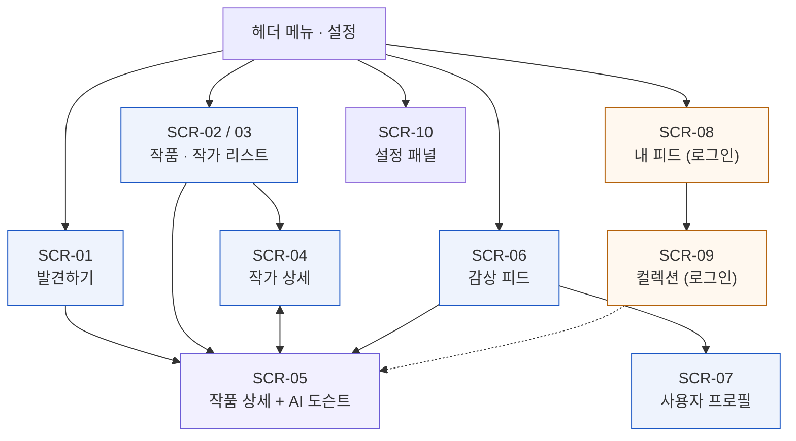

_파란 상자는 로그인 없이, 주황 상자는 로그인 후 이용_

---

## SCR-01 발견하기 (메인)

| 항목 | 내용 |
|---|---|
| 경로 | `/#/gallery` (첫 화면, `/`로 들어와도 이동) |
| 목적 | 그림을 우연히 만나고 다음에 볼 작품을 고르는 전시 공간 |

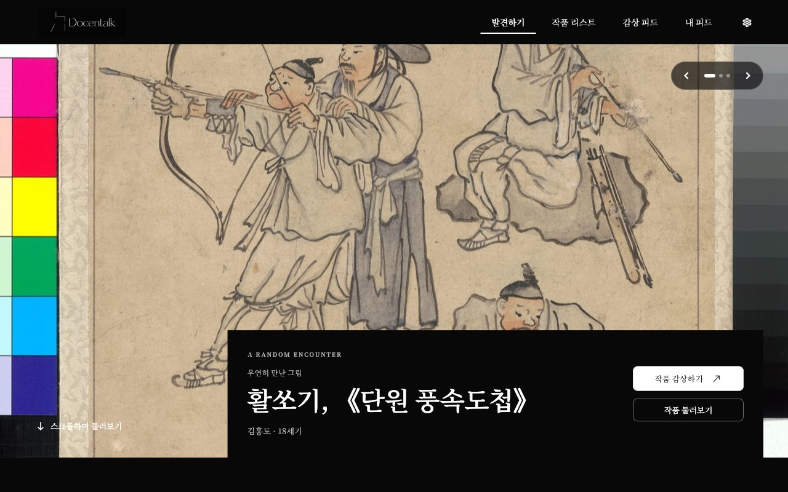
_SCR-01-a 첫 화면: 오늘의 그림 배너_

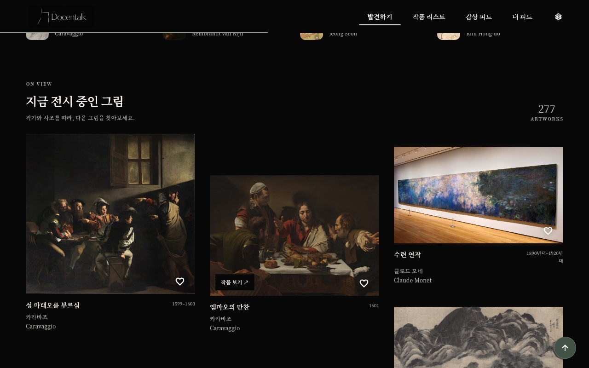
_SCR-01-b 아래로 스크롤: 지금 전시 중인 그림_

| 구성 요소 | 설명 · 동작 | API |
|---|---|---|
| 오늘의 그림 배너 | 작품 3점을 좌우 버튼으로 넘김. 작품 제목·작가·연도 표시. **작품 감상하기** → SCR-05, **작품 둘러보기** → SCR-02 | `GET /api/artworks` |
| 맞춤 추천 (로그인 시) | 좋아요·열람 기록 기반 작품·작가 각 최대 3개와 추천 이유 | `GET /api/me/recommendations/artworks`, `/artists` |
| 작가 줄 | 수집 작가 목록. 누르면 SCR-04 | `GET /api/artists` |
| 지금 전시 중인 그림 | 엇갈린 3열 이미지 목록, 처음 6점 + 더 보기. 마우스를 올리면 **작품 보기**. 하트로 좋아요 | `GET /api/artworks`, `PUT·DELETE /api/artworks/{id}/like` |

## SCR-02 작품 리스트 · SCR-03 작가 리스트

| 항목 | 내용 |
|---|---|
| 경로 | `/#/artworks` (그림 리스트) · `/#/artworks?view=artists` (작가 리스트) |
| 목적 | 수집한 작품 277점과 작가 10명을 검색·필터로 찾기 |

| SCR-02 그림 리스트 | SCR-03 작가 리스트 |
|---|---|
| 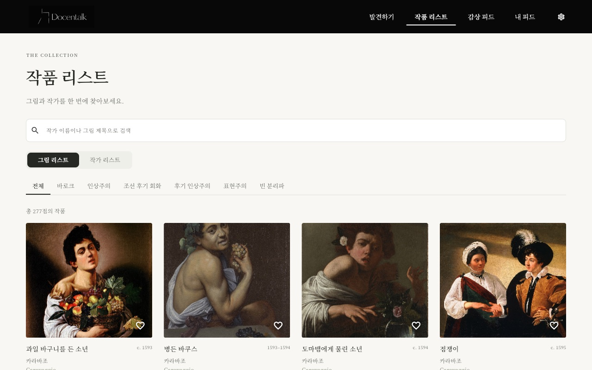 | 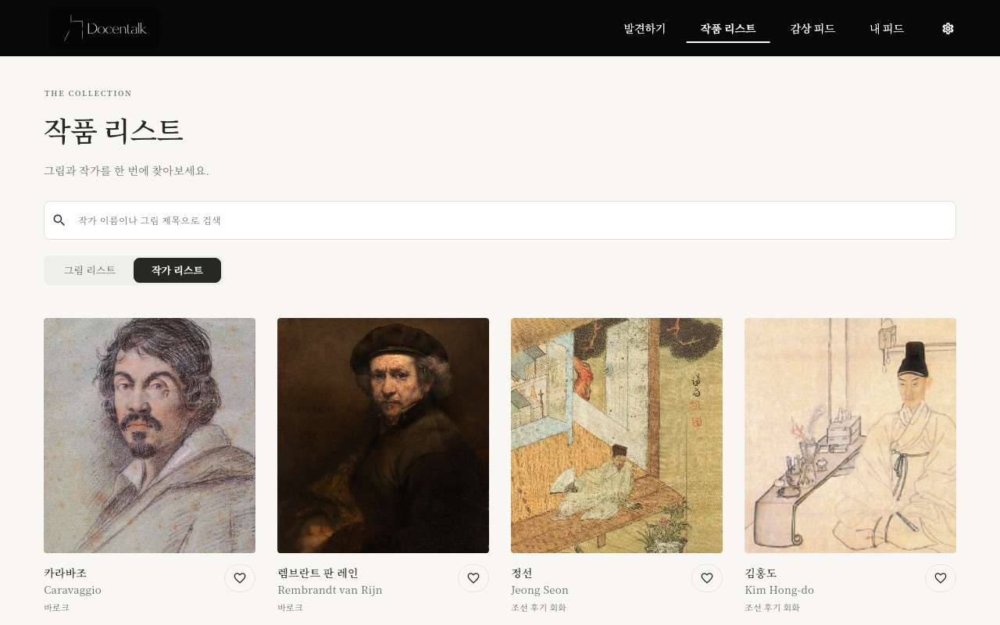 |

| 구성 요소 | 설명 · 동작 | API |
|---|---|---|
| 검색창 | 작가 이름이나 그림 제목으로 바로 거름 (화면 안에서 필터) | - |
| 그림 / 작가 토글 | 그림 리스트(SCR-02)와 작가 리스트(SCR-03) 전환. 주소의 `view` 값도 바뀜 | - |
| 사조 탭 | 전체 · 바로크 · 인상주의 · 조선 후기 회화 · 후기 인상주의 · 표현주의 · 빈 분리파 | `GET /api/movements` |
| 작품 카드 | 이미지, 제목, 연도, 작가. 누르면 SCR-05, 하트로 좋아요(로그인) | `GET /api/artworks`, `PUT·DELETE /api/artworks/{id}/like` |
| 작가 카드 | 초상, 이름(한·영), 사조. 누르면 SCR-04, 하트로 팔로우(로그인) | `GET /api/artists`, `PUT·DELETE /api/artists/{id}/follow` |

## SCR-04 작가 상세

| 항목 | 내용 |
|---|---|
| 경로 | `/#/artist/{id}` |
| 목적 | 작가의 생애 요약과 그 작가의 작품 모아 보기 |

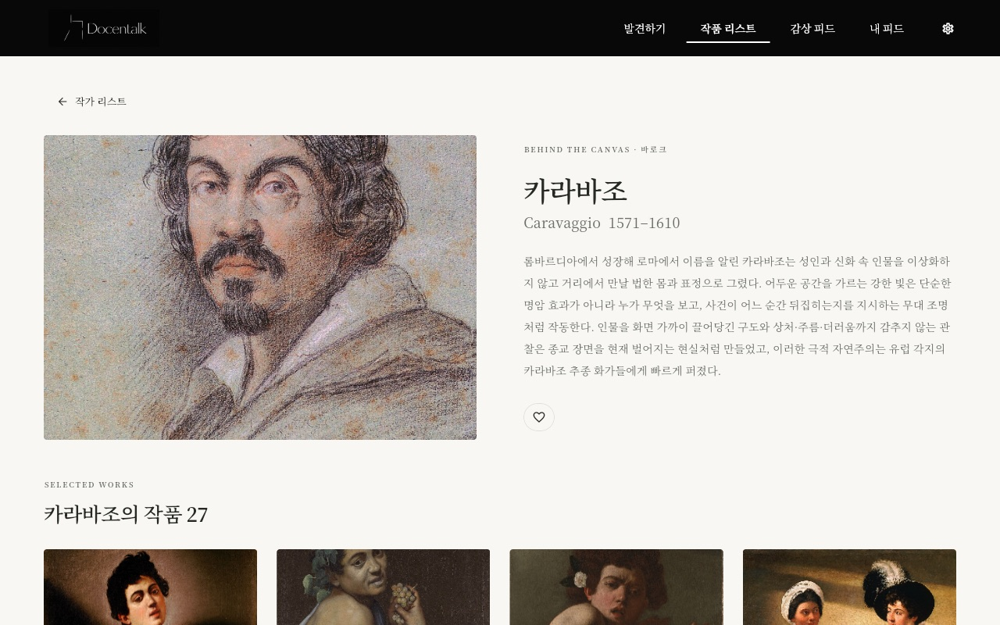
_SCR-04 작가 상세 (카라바조)_

| 구성 요소 | 설명 · 동작 | API |
|---|---|---|
| 뒤로 가기 | 작가 리스트(SCR-03)로 이동 | - |
| 작가 소개 | 초상, 이름(한·영), 생몰년, 사조, 생애 요약. 하트로 팔로우 | `GET /api/artists/{id}`, `PUT·DELETE /api/artists/{id}/follow` |
| 작가의 작품 | 그 작가의 작품 카드 목록. 누르면 SCR-05 | `GET /api/artworks?artist_id={id}` |

## SCR-05 작품 상세 + AI 도슨트

| 항목 | 내용 |
|---|---|
| 경로 | `/#/artwork/{id}` |
| 목적 | 작품 해설을 읽고, 그 작품 범위 안에서 AI 도슨트에게 질문하기 (서비스의 핵심 화면) |

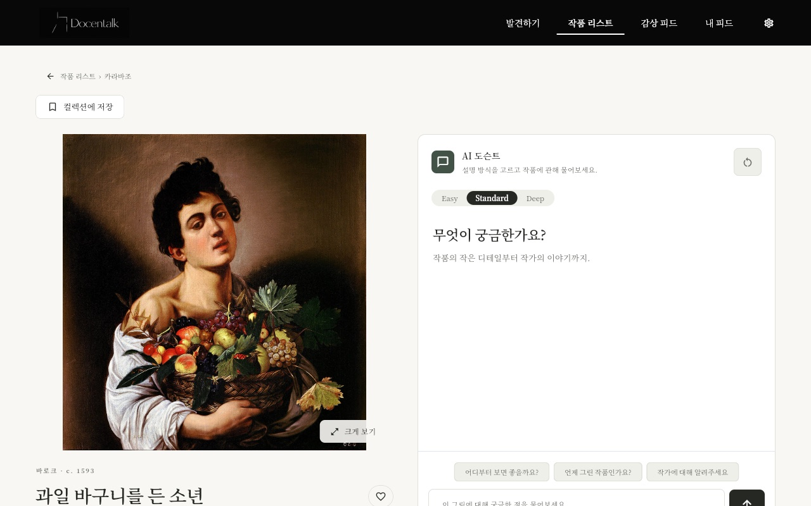
_SCR-05-a 들어왔을 때: 작품 이미지와 AI 도슨트 패널_

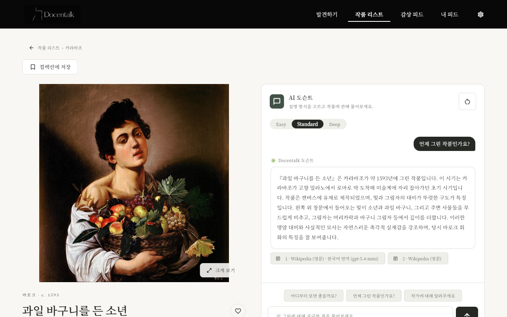
_SCR-05-b 추천 질문 "언제 그린 작품인가요?"를 눌렀을 때: 답변과 근거 출처 2건_

| 구성 요소 | 설명 · 동작 | API |
|---|---|---|
| 경로 · 컬렉션에 저장 | 작품 리스트 › 작가 이동 링크. **컬렉션에 저장**은 로그인 후 내 컬렉션 선택 | `PUT /api/me/collections/{cid}/items/{id}` |
| 작품 이미지 | **크게 보기**로 확대 | `GET /api/artworks/{id}`, `POST /api/artworks/{id}/views` (열람 기록) |
| 작품 정보 | 사조·연도, 제목(한·영), 작가(누르면 SCR-04), 좋아요·팔로우. 탭 **감상 노트** / **작품 정보 · 출처**(재료·소장처·이미지 출처·라이선스) | `PUT·DELETE /api/artworks/{id}/like` |
| AI 도슨트 패널 | 설명 방식 탭 **Easy · Standard · Deep**. 추천 질문 3개, 질문 입력(최대 500자), 보내기. 답변은 글자가 흘러나오듯 표시(SSE). 끝나면 **근거 출처 칩**(문서 제목·출처명)을 붙임. 범위 밖 질문은 "자료에 없다"고 안내 | `POST /api/artworks/{id}/chat/stream` (실패 시 `POST .../chat`) |
| 대화 저장 · 초기화 | 로그인하면 대화가 저장되어 다시 들어와도 복원. 오른쪽 위 버튼으로 초기화 | `GET /api/artworks/{id}/chat/messages`, `DELETE /api/artworks/{id}/chat` |
| 이 작품의 감상 | 감상 입력, **공개 / 비공개** 선택 후 **게시**. 다른 사용자의 공개 감상 목록 | `GET /api/me/diary/artworks/{id}`, `POST /api/me/diary` |
| 함께 보면 좋은 작품 | 비슷한 작품 카드. 누르면 해당 작품의 SCR-05 | `GET /api/artworks/{id}/similar` |

> 답변 흐름: 질문 → LangGraph(분류 → 범위 → 하이브리드 검색 → 생성 → 검증) → 토큰 스트리밍 → 최종 답변·출처·`refused` 확정. 자세한 내용은 [02 시스템 구성도](02_시스템구성도.md) 3장.

## SCR-06 감상 피드

| 항목 | 내용 |
|---|---|
| 경로 | `/#/community` |
| 목적 | 다른 사용자가 공개한 감상 둘러보기 |

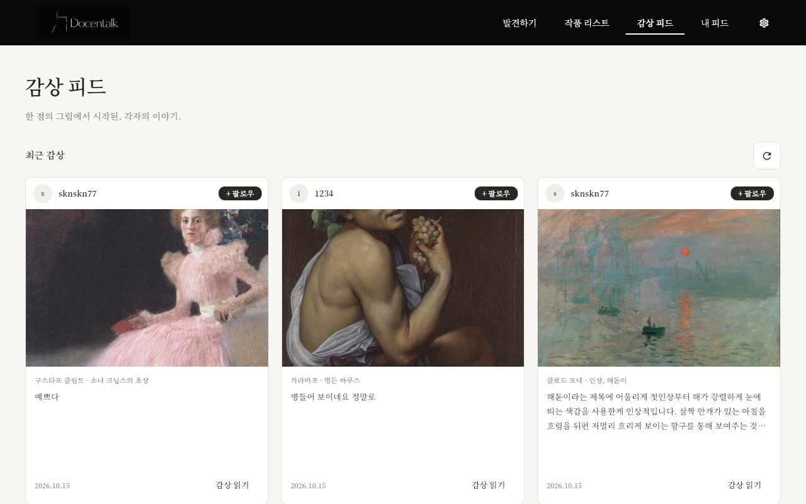
_SCR-06 감상 피드_

| 구성 요소 | 설명 · 동작 | API |
|---|---|---|
| 최근 감상 카드 | 작성자, 작품 이미지, 작가·작품명, 감상 본문, 날짜. 12개씩 불러옴. 새로고침 버튼 | `GET /api/diary/feed` |
| 작성자 · 팔로우 | 작성자를 누르면 SCR-07. **+ 팔로우**(로그인) | `PUT·DELETE /api/users/{id}/follow` |
| 감상 읽기 | 긴 감상 펼쳐 보기, 작품 이미지를 누르면 SCR-05 | - |

## SCR-07 사용자 프로필

| 항목 | 내용 |
|---|---|
| 경로 | `/#/user/{id}` |
| 목적 | 한 사용자의 공개 감상과 팔로우 정보 보기 |

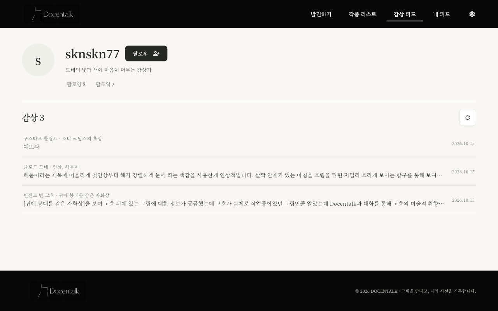
_SCR-07 사용자 프로필_

| 구성 요소 | 설명 · 동작 | API |
|---|---|---|
| 프로필 | 닉네임, 한 줄 취향 소개, 팔로잉·팔로워 수, **팔로우** 버튼 | `GET /api/users/{id}`, `PUT·DELETE /api/users/{id}/follow` |
| 팔로잉 · 팔로워 | 누르면 목록 표시 (팔로우 공개 설정한 사용자만) | `GET /api/users/{id}/following`, `/followers` |
| 감상 목록 | 작가·작품명, 감상 본문, 날짜. 비공개 감상은 표시하지 않음 | `GET /api/users/{id}/diary` |

## SCR-08 내 피드 · SCR-09 컬렉션 상세

| 항목 | 내용 |
|---|---|
| 경로 | `/#/library` (`?tab=posts · collections · calendar`) · `/#/collection/{id}`, `/#/collection/auto/{key}`, `/#/collection/likes` |
| 목적 | 내 감상, 컬렉션, 관심 작가, 감상 캘린더를 모아 보는 개인 공간 **(로그인 필요)** |

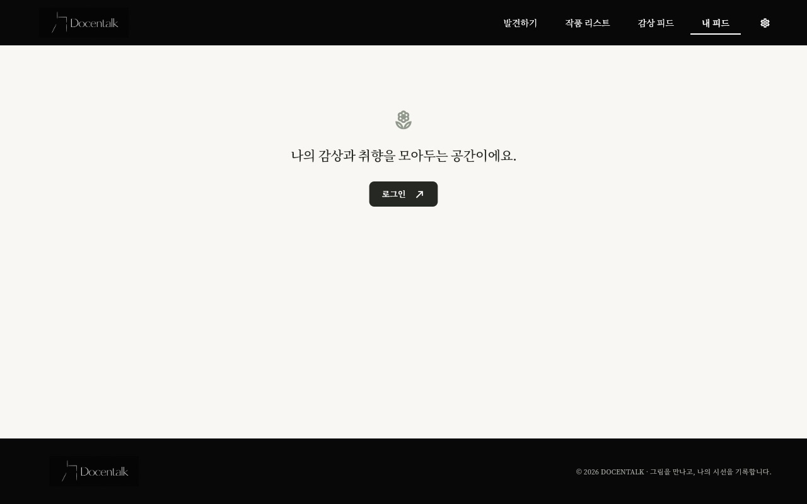
_SCR-08 로그인 전: 안내 문구와 로그인 버튼_

> 로그인 후 화면은 Firebase 계정이 필요해 이 문서에서는 캡처하지 않았다. 구성은 아래 표와 같으며, 3차 배포본과 같은 화면이다.

| 구성 요소 (로그인 후) | 설명 · 동작 | API |
|---|---|---|
| 감상 탭 | 내가 쓴 감상 목록, 공개 여부(자물쇠) 표시, 수정·삭제 | `GET /api/me/diary`, `PUT·DELETE /api/me/diary/{id}` |
| 컬렉션 탭 | 기본 컬렉션 **좋아요한 작품**, 내가 만든 컬렉션, AI 자동 컬렉션(취향 테마). 컬렉션을 누르면 SCR-09 | `GET /api/me/collections`, `/api/me/collections/auto`, `POST /api/me/collections` |
| 관심 작가 | 팔로우한 작가 목록 | `GET /api/me/follows` |
| 감상 캘린더 | 날짜별로 본 작품과 감상. 날짜를 누르면 그날 기록 | `GET /api/me/library/calendar`, `/api/me/library/days/{day}` |
| SCR-09 컬렉션 상세 | 컬렉션 작품 목록(누르면 SCR-05), 이름 변경·작품 빼기·삭제, **컬렉션 AI 대화**(담긴 작품을 바탕으로 질문) | `GET /api/me/collections/{id}/items`, `/api/me/likes`, `POST /api/me/collections/chat` |

## SCR-10 설정 패널

| 항목 | 내용 |
|---|---|
| 경로 | 헤더 오른쪽 톱니 아이콘 (어느 화면에서나 오른쪽에서 열림) |
| 목적 | 로그인·로그아웃과 계정 설정 |

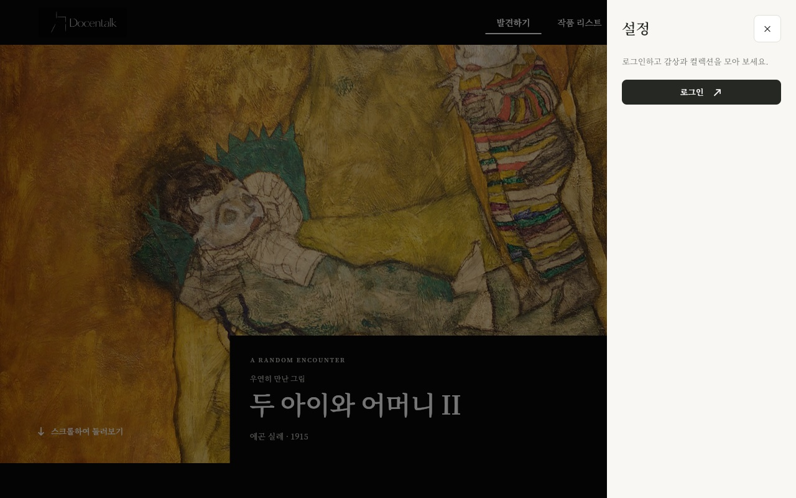
_SCR-10 로그인 전 설정 패널_

| 구성 요소 | 설명 · 동작 | API |
|---|---|---|
| 로그인 | Firebase 로그인 창을 띄움. 로그인 후 ID 토큰을 모든 API 요청에 붙임. 처음 로그인하면 서버가 사용자 생성 | Firebase Auth → 서버 토큰 검증 |
| 프로필 (로그인 후) | 닉네임 확인, 로그아웃 | `GET·PUT /api/me/profile` |
| 팔로우 공개 (로그인 후) | 내 팔로잉·팔로워 목록을 다른 사람에게 보일지 선택 | `GET·PUT /api/me/social` |
| 닫기 | X 버튼 또는 바깥 영역 | - |
